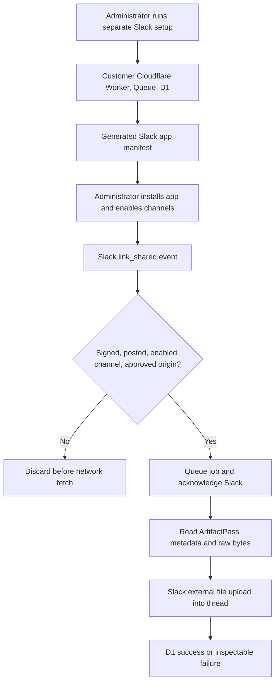

# Customer-Owned Slack Archive - Plan

## Goal Capsule

- **Objective:** A team can opt into automatic Slack copies of ArtifactPass files, so a file shared in an enabled channel remains available in Slack after its ArtifactPass link expires.
- **Means:** A separate setup command deploys a Slack event receiver and archive worker into the team's Cloudflare account and guides an administrator through creating a single-workspace Slack app (KTD1, KTD2).
- **Authority:** The product decisions marked `session-settled` below govern this plan. The requirements govern behavior; key technical decisions govern implementation.
- **Stop conditions:** Do not change normal setup or private deployment behavior. Do not deploy customer resources, register a Slack app, or request credentials during planning. During implementation, stop before any real Cloudflare or Slack account mutation until the account owner explicitly approves it.
- **Execution:** Code in this repository. The implementing agent owns code and local qualification; the customer administrator owns Slack installation, Cloudflare account authorization, channel selection, and production activation.

---

## Product Contract

### Summary

Add an optional `artifactpass slack` workflow for teams that want ArtifactPass links copied into Slack as files. It works with public ArtifactPass by default and can include private deployments. Each team runs its own bot infrastructure and controls exactly which channels archive links.

### Problem Frame

ArtifactPass links expire by design. In a team Slack channel, that can leave the original conversation without the file people were discussing. A Slack copy can solve that, but it creates a durable second copy and a new access boundary. The setup must make ownership, retention, and channel scope clear before archiving begins.

### Key Decisions

- **Customer-owned, opt-in add-on** (session-settled: user-directed — chosen over a centrally managed bot or coupling it to deployment: teams should decide separately whether Slack archiving is worth running). Governs R1, R2, R3.
- **Public source preselected, private sources optional** (session-settled: user-approved — chosen over a private-only default: public links should work immediately while teams can add their own origins). Governs R4, R5.
- **Copies live under Slack retention** (session-settled: user-approved — chosen over extending ArtifactPass link lifetime: Slack should retain the file after the temporary link expires). Governs R10, R11.

### Requirements

**Setup and ownership**

- R1. `pnpm dlx artifactpass slack setup` is a separate opt-in command; `artifactpass install`, `connect`, and `deploy` never invoke it.
- R2. Setup states before authorization that even a public-only team needs its own Cloudflare account, Slack workspace administrator, and any applicable Cloudflare and Slack plan capacity.
- R3. One team-owned Slack app and one customer-account Cloudflare installation serve one Slack workspace; ArtifactPass does not collect its signing secret, bot token, or archived bytes centrally.
- R4. Setup preselects `artifactpass.com` as a source but keeps archiving inactive until the administrator enables a channel; it reports setup as ready only after a live verification.
- R5. The administrator can register a private ArtifactPass origin such as `https://artifacts.example.com`, remove the public origin, and later edit either list. The CLI shows the five-unfurl-domain limit of one Slack app before accepting a sixth domain.
- R6. The setup and later update flow produce a manifest the administrator can apply in Slack without granting ArtifactPass a Slack app-configuration token.

**Archiving behavior**

- R7. Only a posted ArtifactPass share link in an explicitly enabled channel where the bot is a member can start a download; composing, editing, or merely installing the app cannot.
- R8. A qualifying link produces one exact-byte Slack file in the originating message's thread. Repeated Slack deliveries do not create normal duplicate copies.
- R9. The archive fetch accepts only registered HTTPS origins and the ArtifactPass share route; redirects or a URL-derived host change cannot make the Worker fetch another destination.
- R10. Once Slack confirms the upload, the Slack file follows that workspace's retention and access policy independently of ArtifactPass expiry, deletion, or publisher revocation.
- R11. Setup explains that copying can expose a file to the selected Slack channel and that ArtifactPass cannot later revoke the Slack copy.
- R12. If the link expires, the file exceeds a supported limit, Slack rejects the upload, or a token is revoked, the operation ends in an inspectable failure state without falsely claiming an archive exists.

**Administration and visibility**

- R13. An administrator can inspect source domains, enabled channel IDs, delivery counts, and failed jobs without exposing share tokens or file contents.
- R14. An administrator can pause archiving, remove a channel or source, rotate bot credentials, and uninstall the Worker without altering any ArtifactPass deployment.
- R15. Setup must work on a customer's Workers Free account without a mandatory paid Cloudflare service, and must never change the customer's plan or accept billing terms for them.

### Acceptance Examples

- AE1. **Covers R4, R7, R8.** An administrator installs the app, enables one channel, invites the bot, then posts a valid public link. A file appears as a reply to that message; a link pasted into the composer but never sent creates no file.
- AE2. **Covers R5, R8.** The administrator adds `https://artifacts.example.com` and applies the updated Slack manifest. A valid share link from that origin archives in an enabled channel; a link from an unregistered host does not.
- AE3. **Covers R7, R11.** The same valid link posted in a channel not enabled for archiving produces no download or Slack copy, even if Slack delivers a `link_shared` event.
- AE4. **Covers R10, R12.** A copy uploaded before a seven-day ArtifactPass link expires remains in Slack under Slack's policy; a link already expired when processing begins produces a visible failed job, not an empty or invented file.

### Scope Boundaries

- V1 archives files only. It does not implement `@ArtifactPass`, Slack commands, link previews, message-history scanning, backfill, DMs, or Slack Connect shared channels.
- V1 does not promise archive availability before the file visibly appears in Slack. The origin link may expire before retries complete.
- V1 does not bypass Slack workspace upload restrictions or retention settings.
- Considered but not built: in-channel failure messages. They need `chat:write`, which broadens the initial permission set. Reconsider if pilot teams cannot detect failures through the administrator status command in time.

#### Deferred to Follow-Up Work

- A guided `@ArtifactPass` share action, only if users request it after the archive flow is stable.
- Multi-workspace distribution, a Slack Marketplace listing, and more than five source domains per workspace.
- Automated Slack manifest updates, only if manual updates prove burdensome enough to justify an app-configuration token.

---

## Planning Contract

### Key Technical Decisions

- KTD1. **Separate companion Worker:** Add `apps/slack-archive` rather than changing the public or private ArtifactPass Worker. It uses the existing pnpm/TypeScript toolchain and customer-account deployment pattern. (session-settled: user-directed — chosen over modifying every ArtifactPass deployment: Slack is an independent add-on.)
- KTD2. **Single-workspace Slack app from a generated manifest:** Provision the customer event endpoint first, then generate a manifest containing its HTTPS request URL, `link_shared`, registered domains, and only `links:read` and `files:write`. The administrator creates and installs the app; v1 does not need Slack OAuth distribution. [Slack app lifecycle](https://docs.slack.dev/app-management/distribution/), [manifest setup](https://docs.slack.dev/app-manifests/configuring-apps-with-app-manifests/).
- KTD3. **Wrangler account authorization for the add-on:** Use the CLI's bundled Wrangler to authorize and deploy into the customer's selected Cloudflare account. Do not silently broaden the existing private-deployment OAuth client's exact scope profiles, which currently have no Queue scope (`packages/setup-cli/src/cloudflare/oauth.ts`). Confirm supported Wrangler Queue/D1 operations in a disposable account before making the setup wizard promise one-step provisioning.
- KTD4. **Fast verified intake, async transfer:** Verify Slack's signature and timestamp, reject unapproved event context, then enqueue a small job and acknowledge within Slack's three-second deadline. A Queue consumer performs the network transfer. Queue delivery is at least once, so D1 tracks a hash-based job identity and outcome. [Slack Events API](https://docs.slack.dev/apis/events-api/), [Slack request verification](https://docs.slack.dev/authentication/verifying-requests-from-slack/), [Cloudflare Queue delivery](https://developers.cloudflare.com/queues/reference/delivery-guarantees/).
- KTD5. **Posted-message discrimination:** Ignore Slack composer events, including pseudo channel and timestamp values. On payloads without `source`, accept only a real channel ID and numeric posted-message timestamp; verify this path during Enterprise qualification. Use the parent `thread_ts` when present, otherwise the posted message's timestamp. [Slack `link_shared`](https://docs.slack.dev/reference/events/link_shared/).
- KTD6. **Stream exact bytes without an intermediate bucket:** Read ArtifactPass metadata for filename, size, and expiry, then stream `/a/<token>/raw` to Slack's external upload URL and complete it in the originating thread. Use no ArtifactPass upload API and no R2 copy in the bot. A transient Queue payload necessarily contains the bearer URL; customer-owned Cloudflare resources hold it only until delivery/retention, and logs never print it. [Slack upload start](https://docs.slack.dev/reference/methods/files.getUploadURLExternal/), [Slack upload completion](https://docs.slack.dev/reference/methods/files.completeUploadExternal/), `apps/artifact-service/src/server/routes/shares.ts`.
- KTD7. **No false exactly-once claim:** D1 prevents ordinary duplicate delivery, but Slack upload completion and the D1 success write are not one transaction. An ambiguous completion is marked `needs-review` rather than blindly retried; the administrator checks the thread. This avoids treating an uncertain second upload as safe.

### High-Level Technical Design



The five-domain budget belongs to the Slack app manifest, not the Worker. The Worker also enforces its own source allowlist so a stale or broader manifest cannot trigger an unapproved fetch.

The administrator-facing command surface is `slack setup`, `slack status`, `slack sources add|remove`, `slack channels add|remove`, `slack pause|resume`, `slack update`, and `slack uninstall`. Channel commands accept a Slack channel link or ID, rather than requesting a channel-list permission. Adding or removing a source generates the revised manifest and clearly waits for the administrator to apply it in Slack before reporting that source active.

Delivery state is `queued → transferring → succeeded | failed | needs-review`. A job is terminal when the source is expired, the upload is disallowed, or Slack's outcome is ambiguous. Retriable network and rate-limit errors stop at the source expiry, Queue retention, or the configured retry budget, whichever arrives first. Cloudflare Free Queue messages have a fixed 24-hour retention window. [Queue limits](https://developers.cloudflare.com/queues/platform/limits/).

### Output Structure

```text
apps/slack-archive/
  src/
    event-receiver.ts
    archive-consumer.ts
    source-policy.ts
    slack-upload.ts
    delivery-store.ts
  migrations/
  test/
packages/setup-cli/src/slack/
  setup.ts
  configuration.ts
  manifest.ts
  status.ts
packages/setup-cli/test/
docs/slack-archive.md
```

### System-Wide Impact

- ArtifactPass public and private Worker routes remain unchanged. The existing `/a/:shareToken/manifest` and `/a/:shareToken/raw` routes are the integration boundary.
- The bot's Cloudflare account and Slack workspace admins can access their own secrets and copied files. Public ArtifactPass infrastructure admins still control the public source until a link expires; private deployment admins control their source.
- Queues, D1, Worker requests, ArtifactPass reads, and Slack uploads are billed or counted in the customer's accounts, except reads from the public ArtifactPass service. The queue carries only link jobs, not artifact bytes.
- On Workers Free, the bot and a private ArtifactPass deployment in the same Cloudflare account share account-level allowances. For public-only links, the customer's bot account bears its own Worker, Queue, and D1 use; the public ArtifactPass account serves the source reads.
- The setup CLI package changes, so release it through the repository's RC → staging qualification → stable sequence. Do not redeploy public or private ArtifactPass services solely for this add-on.

### Risks and Qualification Gates

- **Free-tier viability is unproven until a live transfer test:** As of 2026-10-22, Workers Free includes 100,000 requests/day and 10 ms CPU per invocation; Queues includes 10,000 operations/day and 24-hour retention; D1 includes 5 million rows read/day, 100,000 rows written/day, 10 databases/account, 500 MB/database, and 5 GB total storage. A normal Queue message costs about three operations, so roughly 3,300 archives/day is an optimistic account-wide ceiling before retries or other Queue traffic. The bot uses no R2 storage, but each private-source archive adds a source read against that deployment's R2 allowance. Workers, Queues, and D1 on Free fail or stop at their limits rather than automatically upgrading; an existing R2 subscription can bill for use above its monthly free allowance. Setup must preflight capacity and never upgrade the customer's account. Prove 25 MiB and 64 MiB streaming under the Free CPU/memory limits in a disposable account before calling v1 free-compatible. If it fails, change the transfer design or return for an explicit product decision; do not silently require Workers Paid. [Workers limits](https://developers.cloudflare.com/workers/platform/limits/), [Queues pricing](https://developers.cloudflare.com/queues/platform/pricing/), [D1 pricing](https://developers.cloudflare.com/d1/platform/pricing/), [D1 limits](https://developers.cloudflare.com/d1/platform/limits/), [R2 pricing](https://developers.cloudflare.com/r2/pricing/).
- **Slack event coverage:** Qualify sent root messages and replies in public and private channels. Composer events must never copy. Treat Enterprise and Slack Connect behavior as unproven until exercised; do not claim support from payload shape alone.
- **Link secrecy and SSRF:** Reject URL credentials, non-HTTPS schemes, unregistered exact hosts, unexpected path shapes, redirects, oversized or missing lengths, and invalid filenames before fetching or uploading. Redact URL paths, tokens, headers, and artifact data in logs and D1.
- **Upload limits and retention:** The protocol caps both agent publication and public human uploads at 25 MiB per artifact (`packages/artifact-protocol/src/index.ts`, `apps/artifact-service/src/server/storage/validation.ts`). The 64 MiB constant in `apps/artifact-service/src/server/routes/artifacts.ts` is a rolling public-upload budget, not a per-file limit. Stream rather than buffer and verify actual Slack workspace policy and Cloudflare plan limits before promising larger files.
- **Retry and duplicate gap:** A successful Slack upload followed by a lost acknowledgment cannot be made exactly-once without more Slack read authority. Keep `needs-review` visible and do not silently repeat that upload.
- **Operational ownership:** A customer must update this separately deployed bot when ArtifactPass releases a compatible bot version. Provide an explicit update command and compatibility notes; no silent customer deployment changes.

---

## Implementation Units

### U1. Define source and event contracts

- **Goal:** Make eligibility and URL safety testable before any Cloudflare resources exist.
- **Requirements:** R5, R7, R9.
- **Dependencies:** None.
- **Files:** `apps/slack-archive/src/source-policy.ts`, `apps/slack-archive/src/event-receiver.ts`, `apps/slack-archive/test/source-policy.test.ts`, `apps/slack-archive/test/event-policy.test.ts`.
- **Approach:** Parse only registered HTTPS ArtifactPass share URLs and posted Slack `link_shared` payloads. Apply channel allowlist and bot-membership checks before queuing or fetching. Keep the event contract small enough to serialize without message text.
- **Patterns to follow:** `apps/artifact-service/src/server/observability/redact-request-path.ts`; `apps/artifact-service/src/server/routes/shares.ts`.
- **Test scenarios:**
  - A valid posted `/a/<token>` link in an enabled channel becomes one eligible job.
  - A composer event, disallowed channel, absent bot membership, duplicate link in one event, or URL with a foreign host produces no job.
  - A redirect, encoded host trick, URL credentials, non-HTTPS scheme, or non-share path cannot expand the approved fetch target.
- **Verification:** Eligibility tests show that no rejected event reaches the fetch or Queue boundary.

### U2. Build verified intake and durable delivery state

- **Goal:** Accept genuine Slack events promptly and preserve a recoverable job outcome.
- **Requirements:** R3, R7, R12, R13.
- **Dependencies:** U1.
- **Files:** `apps/slack-archive/src/event-receiver.ts`, `apps/slack-archive/src/delivery-store.ts`, `apps/slack-archive/migrations/0001-deliveries.sql`, `apps/slack-archive/test/event-receiver.test.ts`, `apps/slack-archive/test/delivery-store.test.ts`.
- **Approach:** Verify the raw-body HMAC and freshness before parsing. Handle Slack URL verification, enqueue only eligible events, and record a token-free job hash and status. Use an atomic claim so Queue redelivery cannot normally create a second upload.
- **Execution note:** Start with a signed-request and retry integration test; the three-second acknowledgment is the contract this unit protects.
- **Test scenarios:**
  - A valid signed event receives a timely acknowledgment and one queued job.
  - Invalid signature, stale timestamp, wrong team/app ID, and malformed JSON are rejected without a job.
  - Duplicate Slack delivery or concurrent Queue claims leave one active delivery record.
  - A failed Queue send is not acknowledged as successfully archived.
- **Verification:** Local event/Queue integration proves acknowledgment, rejection, redelivery, and status transitions.

### U3. Transfer source bytes into the Slack thread

- **Goal:** Turn an eligible live link into a durable Slack file without storing a bot-side copy.
- **Requirements:** R8, R9, R10, R12.
- **Dependencies:** U1, U2.
- **Files:** `apps/slack-archive/src/archive-consumer.ts`, `apps/slack-archive/src/slack-upload.ts`, `apps/slack-archive/test/archive-consumer.test.ts`, `apps/slack-archive/test/slack-upload.test.ts`.
- **Approach:** Retrieve metadata, enforce size and expiry, stream raw bytes to Slack's external upload endpoint, then complete in the source thread. Separate definite retryable failures from definite terminal failures and ambiguous Slack completion per KTD7.
- **Test scenarios:**
  - A public source and a private-deployment source each yield byte-identical Slack files with the source filename in the correct root-message or reply thread.
  - An expired link, unsupported size, missing length, disallowed file type, and revoked bot token become visible failures without a success claim.
  - A transient Slack rate limit retries within the link's remaining lifetime; an ambiguous completion becomes `needs-review` without a blind second upload.
- **Verification:** Mocked network integration covers error classes; a customer-approved disposable live workspace proves actual thread placement and downloadable bytes.
- **Execution note:** Before relying on this transfer design, run 25 MiB and 64 MiB cases on Workers Free and inspect CPU, memory, Queue, and D1 metrics; preserve streaming only if both fit R15.

### U4. Add the independent setup and update CLI

- **Goal:** Let a team provision and manage the add-on without disturbing normal ArtifactPass installation or deployment.
- **Requirements:** R1, R2, R3, R4, R5, R6, R11, R14.
- **Dependencies:** U1, U2, U3.
- **Files:** `packages/setup-cli/src/cli.ts`, `packages/setup-cli/src/slack/setup.ts`, `packages/setup-cli/src/slack/configuration.ts`, `packages/setup-cli/src/slack/manifest.ts`, `packages/setup-cli/src/slack/status.ts`, `packages/setup-cli/test/slack-setup.test.ts`, `packages/setup-cli/test/slack-manifest.test.ts`.
- **Approach:** Reuse the existing terminal prompt and progress conventions. Guide Cloudflare account selection, Worker/Queue/D1 provisioning, manifest creation, Slack installation, secret handoff directly to Cloudflare, domain registration, explicit channel enablement, live verification, status, pause, update, and uninstall. Persist non-secret local setup state so interruption can resume. Never show secrets in prompts, errors, files, or command history.
- **Execution note:** The CLI's Cloudflare and Slack instructions must include visible links that the administrator can open in the intended browser profile.
- **Test scenarios:**
  - A public-only setup shows the Cloudflare prerequisite, preselects the public origin, and remains inactive until a channel is enabled; it reports ready only after live verification succeeds.
  - Adding a private origin produces a new manifest; a sixth unfurl domain is rejected before Cloudflare or Slack changes.
  - Cancel and resume preserve non-secret state and do not create a partially active bot; normal `install`, `connect`, and `deploy` flows remain unchanged.
  - Status, pause, source/channel removal, credential rotation, and uninstall affect only the selected Slack add-on.
- **Verification:** A packed CLI smoke and guided disposable-account run prove the published command and interruption behavior, not merely source-level tests.

### U5. Document security, limits, and operator recovery

- **Goal:** Make a customer administrator able to decide, set up, and maintain the integration without hidden retention or permission surprises.
- **Requirements:** R2, R5, R11, R12, R13, R14.
- **Dependencies:** U4.
- **Files:** `docs/slack-archive.md`, `docs/cli-reference.md`, `docs/security-model.md`, `packages/setup-cli/README.md`.
- **Approach:** Show the public-only and public-plus-private paths, one-workspace/one-app model, two Slack scopes, five-domain budget, exact customer-owned resources, channel and bot-membership activation, Slack retention, update/uninstall, and status-based recovery. Keep private deployment documentation linked rather than repeating its wizard.
- **Test expectation:** None for prose alone; the setup commands and account prerequisites must be checked against the packed CLI and live qualification output.
- **Verification:** A first-time administrator can follow the guide from an empty Slack app and Cloudflare account through a verified archive, then identify how to stop it.

---

## Verification Contract

| Gate | Applies to | Proof |
| --- | --- | --- |
| `pnpm --dir apps/slack-archive test` and `pnpm --dir apps/slack-archive typecheck` | U1–U3 | Event validation, signature handling, Queue state, transfer, and failure classes pass. |
| `pnpm --dir packages/setup-cli test` and `pnpm --dir packages/setup-cli typecheck` | U4 | Setup, manifest, status, interruption, and existing CLI behavior pass. |
| `pnpm test:worker` | Any change to the existing ArtifactPass Worker | Existing share and auth routes still work; skip if those routes remain untouched. |
| `pnpm check` | Before the RC | Repository lint, typecheck, tests, generated artifacts, and builds pass. |
| `pnpm release:check` and `pnpm test:packed-install` | Once for the RC | Secret scan, distribution checks, and real installed CLI entry point pass. |
| Disposable Cloudflare account and Slack workspace pilot | Before stable | Posted public and private links archive in correct threads; excluded and failure cases do not claim success. |
| Workers Free 25 MiB and 64 MiB pilot | Before calling setup free-compatible | Uploads finish without CPU/memory termination or a paid upgrade; account-level Worker, Queue, D1, and R2 usage remains within the published limits. |

Live account mutations require the owner's explicit approval. Local unit and integration tests cannot substitute for the disposable-account pilot because Slack's event timing, thread placement, workspace file policy, and customer Cloudflare permissions are external contracts.

Release qualification uses the repository's established order: merge to `main`, publish one RC, run `pnpm release:check` and the packed-install gate, qualify that exact RC with an approved disposable Cloudflare account and Slack workspace, then promote its byte-equivalent stable package to npm `latest`. The pilot must include a posted public link, a private-origin link after manifest activation, a disabled channel, an expired link, a composer event, duplicate delivery, a real Slack thread attachment, and the Slack copy still available after source expiry. Do not redeploy the public or private ArtifactPass Workers for this add-on alone.

---

## Definition of Done

- A team can complete the separate setup and see a real Slack file for an approved posted link; `install`, `connect`, and `deploy` remain unchanged.
- Public-only and public-plus-private paths, channel opt-in, five-domain limit, retention disclosure, status, pause, update, and uninstall behave as specified.
- No unexpected origin is fetched, no unsent link is archived, no secret or share token appears in logs or persistent status, and ambiguous uploads never report success.
- The packed RC and disposable-account pilot pass before stable publication. The released package is the qualified build, not an untested rebuild.
- The final diff contains no abandoned experiment, extra Slack scope, unnecessary ArtifactPass Worker change, or generated secret.

---

## Appendix

The Slack manifest's `features.unfurl_domains` field allows at most five domains. Slack's `link_shared` event distinguishes composer from posted-message sources; composer channel and timestamp fields are not usable for file uploads. [Manifest reference](https://docs.slack.dev/reference/app-manifest/), [`link_shared` reference](https://docs.slack.dev/reference/events/link_shared/).

ArtifactPass's source integration is already present in `apps/artifact-service/src/server/routes/shares.ts`: the share manifest supplies metadata and `/raw` returns source bytes. The add-on should consume these public bearer routes, not acquire upload authority or modify deployment-specific authentication.
