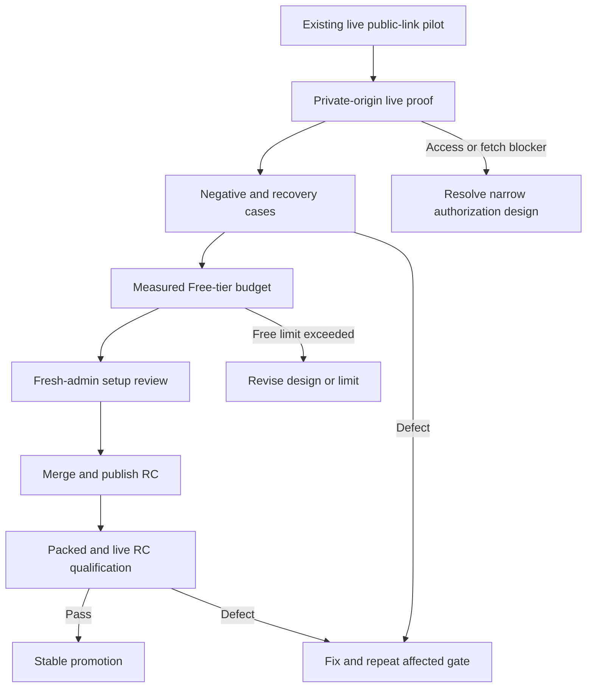

# Slack Archive Pilot Qualification - Plan

## Goal Capsule

- **Objective:** A team can install the optional Slack archive with a known Free-tier operating budget and trust that eligible ArtifactPass links become one correct Slack file, while ineligible or failed links never appear archived.
- **Means:** Qualify the existing customer-owned bot against a real private deployment, failure cases, and measured Cloudflare usage before releasing its CLI (KTD1, KTD2).
- **Authority:** The customer-owned, opt-in, public-by-default, minimal-permission product contract in `docs/plans/2026-10-22-1014-feat-customer-owned-slack-archive-plan.md` remains authoritative. This plan covers the remaining qualification and release work, not a redesign.
- **Stop conditions:** Do not add Slack message-history or `chat:write` scopes, change normal ArtifactPass installation or private deployment, upgrade a Cloudflare or Slack plan, or mutate another customer's account. Live account changes require the account owner's approval.
- **Execution:** Code and release work in this repository; the pilot workspace and Cloudflare account are used only for approved, synthetic-file qualification.

---

## Product Contract

### Summary

Finish and qualify the separate Slack archive add-on already built in `apps/slack-archive` and `packages/setup-cli/src/slack`. Public-link archiving of HTML, Markdown, and PDF files has been observed in one opted-in pilot channel. Private-origin behavior, adverse outcomes, sustained Free-tier usage, first-time onboarding, and the published package remain unqualified.

### Problem Frame

The successful three-file pilot proves basic thread placement and exact bytes, but it does not establish that a customer can rely on private links, failures, costs, or a fresh installation. Releasing from that evidence would turn untested assumptions into product promises.

### Requirements

**Live archive behavior**

- R1. An approved private ArtifactPass origin archives a valid link into the originating Slack thread with exact source bytes, without requiring broader Slack scopes.
- R2. Disabled channels, unapproved origins, composer-only links, expired links, and repeated events produce no unintended Slack copy or false success state.
- R3. Transient errors may retry within the source lifetime; an uncertain Slack completion remains inspectable as `needs-review` without an automatic duplicate.

**Customer operation**

- R4. A first-time administrator can activate, verify, pause, recover, update, and remove the add-on using the shipped CLI and documentation without guessing which Cloudflare or Slack action comes next.
- R5. The Free-tier guidance states an evidence-backed team-wide daily limit and the conditions that lower it, based on measured Worker, Queue, and D1 use rather than the transfer-only POC.

**Release**

- R6. Only the exact RC package that passed the live pilot and packed-install checks may be promoted to stable; the archive add-on must not trigger a public or private ArtifactPass Worker deployment.

### Acceptance Examples

- AE1. **Covers R1.** A fresh link from `https://artifacts.example.com` is posted in an enabled pilot channel. The bot replies in that message's thread with one file whose downloaded bytes match the source.
- AE2. **Covers R2, R3.** The same Slack event is delivered twice. The thread gains only one file, and status reports one successful delivery; an ambiguous Slack completion instead reports `needs-review` until inspected.
- AE3. **Covers R2.** A valid link posted in a disabled channel, an unapproved link, or an expired link yields no file. Status distinguishes ignored context from a qualifying job that failed.
- AE4. **Covers R1, R2.** A file copied before its ArtifactPass link expires remains downloadable in Slack after the source link expires, subject to the workspace's retention policy.
- AE5. **Covers R4.** A new administrator follows the published setup guide from an unconfigured account through one verified file, then finds the correct pause and recovery action without help from the implementer.
- AE6. **Covers R5, R6.** The operating limit cites measured account usage and explicit headroom; the packed RC passes the live pilot before its byte-equivalent stable package reaches `latest`.

### Scope Boundaries

- The bot remains a separate, customer-owned, channel-opt-in add-on. Public `artifactpass.com` is the default source; private origins are optional.
- No `@ArtifactPass` command, backfill, DMs, Slack Connect, Marketplace distribution, or in-channel failure messages enter this release. Those require new product and permission decisions.
- This plan does not fix unrelated homepage behavior. The repository-wide `zod` and `undici` audit failures are a release prerequisite to clear separately, not a reason to widen the Slack feature diff.

---

## Planning Contract

### Key Technical Decisions

- KTD1. **Qualify the existing architecture before changing it.** Use the deployed Worker, Queue, D1 delivery state, and Slack app from the pilot as the behavior under test; fix only defects the gates reveal. This avoids mistaking a redesigned local mock for proof of the customer-owned integration.
- KTD2. **Keep private-source authorization explicit.** First verify how the private share manifest and raw routes are reached from the bot. If Cloudflare Access blocks them, stop and decide the narrowest customer-owned credential path before adding one; never bypass Access or silently broaden bot authority. Governs R1.
- KTD3. **Treat capacity as an account-wide budget.** Compare before/after Cloudflare metrics for the automatic event-to-thread flow, including Queue writes, reads, deletes, retries, Worker invocations, and D1 operations. Derive a conservative account-adjusted daily cap from measured per-file costs and remaining quotas; call it load-tested only if a sustained daily trial actually reaches that volume. Governs R5.
- KTD4. **Keep uncertain uploads visible, not automatically repeated.** Slack file completion and the D1 success write cannot be made atomic under the current two-scope app; preserve `needs-review` rather than claiming exactly-once delivery. Governs R3.
- KTD5. **Release through the repository's established RC path.** Merge the qualifying changes to `main`, clear repository-wide release gates, publish one RC, qualify that exact archive in the pilot, then promote its byte-equivalent stable package. Governs R6.

### High-Level Technical Design

### System-Wide Impact

- The Slack customer's Cloudflare account bears bot Worker, Queue, and D1 use. A private ArtifactPass deployment in that account also consumes its existing Worker and R2 allowances. Slack stores the retained file under the workspace's policy.
- The bot handles bearer share URLs transiently in Queue jobs; persistent status and logs must not expose them. A Slack copy is independent of ArtifactPass expiry or revocation.
- The existing public and private ArtifactPass Workers are source services, not deployment targets for this add-on's release.

### Risks and Dependencies

- A private deployment may put its share routes behind Cloudflare Access. R1 remains a gate until the actual pilot proves the authorization boundary.
- A successful Slack upload followed by a lost acknowledgment can leave `needs-review`; removing that state would risk duplicates.
- Free-tier allowances and other account traffic can change. Recheck current Cloudflare limits at measurement time; never present 3,000 files/day as a tested fact until the automatic pipeline supports it.
- The current repository-wide dependency audit reports high-severity `zod` and transitive `undici` advisories. Clear this in a separate prerequisite change before treating the RC as release-qualified.

---

## Implementation Units

### U1. Prove private-origin archiving

- **Goal:** Establish that a customer-added private deployment archives correctly without an unplanned access bypass.
- **Requirements:** R1; AE1.
- **Dependencies:** Existing public pilot and account-owner approval for live manifest/source changes.
- **Files:** `packages/setup-cli/src/slack/manifest.ts`, `packages/setup-cli/src/slack/configuration.ts`, `apps/slack-archive/src/source-policy.ts`, `apps/slack-archive/src/archive-consumer.ts`, `packages/setup-cli/test/slack-manifest.test.ts`, `apps/slack-archive/test/archive-consumer.test.ts`, `docs/slack-archive.md` (change only where the live proof exposes a gap).
- **Approach:** Register the private HTTPS origin in both the Worker allowlist and Slack manifest. Confirm the source manifest and raw file are reachable under the deployment's intended share policy, then post a synthetic file link.
- **Test scenarios:**
  - An approved private link posted in an enabled channel yields one same-thread file with matching filename, size, and bytes.
  - The same link on an unapproved origin is not fetched, even if Slack reports it.
  - If Access denies the bot's source request, status reports a failure without relaxing the share policy.
- **Verification:** Capture the source and Slack file checksums, thread identity, delivery status, and any Access decision. If authorization fails, resolve KTD2 before advancing.

### U2. Qualify exclusions and recovery

- **Goal:** Make negative and ambiguous outcomes truthful and safe in live operation.
- **Requirements:** R1, R2, R3; AE2, AE3, AE4.
- **Dependencies:** U1, so both public and private sources can be exercised.
- **Files:** `apps/slack-archive/src/event-receiver.ts`, `apps/slack-archive/src/delivery-store.ts`, `apps/slack-archive/src/archive-consumer.ts`, `apps/slack-archive/test/event-receiver.test.ts`, `apps/slack-archive/test/delivery-store.test.ts`, `apps/slack-archive/test/archive-consumer.test.ts`, `packages/setup-cli/src/slack/status.ts` (change only for observed defects).
- **Approach:** Run controlled posted-link and delivery cases in the pilot. Inspect both Slack threads and operator status; do not infer success from HTTP acceptance alone.
- **Test scenarios:**
  - Disabled-channel, unapproved-origin, composer-only, and already-expired links create no Slack file.
  - Repeated Slack event delivery and Queue redelivery do not create an ordinary duplicate file.
  - A definite transient network or rate-limit failure retries within the source lifetime and ends with a truthful outcome.
  - An uncertain Slack completion is `needs-review` and produces no blind automatic second upload.
  - A Slack copy uploaded before source expiry stays downloadable after that source link expires, under the workspace's retention settings.
- **Verification:** For each case, record the Slack thread contents and matching D1/status outcome, with no share token or file bytes in persistent diagnostics.

### U3. Establish the Free-tier operating limit

- **Goal:** Replace the proposed daily budget with a defensible limit for the automatic bot.
- **Requirements:** R5; AE6.
- **Dependencies:** U2, so retries and failures are included in the cost model.
- **Files:** `docs/slack-archive-free-tier.md`, `docs/slack-archive.md`, `packages/setup-cli/src/slack/status.ts`, `packages/setup-cli/test/slack-status.test.ts` (status changes only if measured usage needs to be surfaced).
- **Approach:** Measure account baseline and bounded synthetic runs across small and large files, burst and steady rates, and retry cases. Attribute Worker, Queue, D1, and source R2 use separately, including other account traffic. Do not use Slack storage as the Cloudflare cost argument.
- **Test scenarios:**
  - A representative successful archive exposes actual per-file operations and CPU use.
  - A retrying archive exposes worst-observed extra operations and remains within the proposed headroom.
  - A 25 MiB source, the current ArtifactPass maximum for both agent and human uploads, completes on Free or forces a smaller documented supported limit. Keep any 64 MiB direct-transfer stress test separate from claims about valid ArtifactPass links.
- **Verification:** Publish the observed sample, calculation, account-sharing assumptions, and conservative team-wide daily/monthly limit. Label the result as quota-derived unless a sustained trial reaches it; if a threshold cannot be supported, lower the claim or return to KTD3 for a design decision.

### U4. Make first-time setup and recovery unambiguous

- **Goal:** Let another administrator reproduce the pilot without the implementer guiding every screen.
- **Requirements:** R4; AE5.
- **Dependencies:** U1–U3, so copy and limits reflect real behavior.
- **Files:** `docs/slack-archive.md`, `docs/cli-reference.md`, `packages/setup-cli/src/slack/setup.ts`, `packages/setup-cli/src/slack/activation.ts`, `packages/setup-cli/src/slack/status.ts`, `packages/setup-cli/test/slack-setup.test.ts`, `packages/setup-cli/test/slack-activation.test.ts` (CLI changes only for observed confusion).
- **Approach:** Walk through an unconfigured Cloudflare/Slack setup using the packed CLI. Check the printed browser links, manifest and secret handoff, channel opt-in, bot invitation, live verification, pause/recovery, and uninstall instructions.
- **Test scenarios:**
  - A public-only administrator reaches one verified archive without touching private deployment setup.
  - An administrator adding a private origin knows to apply the revised Slack manifest before expecting link events.
  - Interrupting setup and resuming does not mark an unverified bot ready.
  - An expired link, missing bot membership, or `needs-review` delivery leads to an actionable status explanation.
- **Verification:** A first-time walkthrough produces the expected file and recovery path with no hidden credential request, plan upgrade, or extra Slack scope.

### U5. Qualify and promote the exact package

- **Goal:** Ship the add-on only after the code and packed CLI reproduce the live pilot.
- **Requirements:** R6; AE6.
- **Dependencies:** U1–U4 and a green repository-wide dependency audit.
- **Files:** `package.json`, `packages/setup-cli/package.json`, `packages/setup-cli/README.md`, `docs/slack-archive.md`, `docs/releases/` (version and release-note files only as required by the existing release workflow).
- **Approach:** Review the final diff for unrelated Worker or scope changes, merge it, publish one RC, install that exact tarball in a clean workspace, and repeat the public/private and recovery smoke against the pilot. Promote only the byte-equivalent stable package.
- **Test expectation:** No new product test is needed solely for a version bump; the packed CLI and live RC behavior are the gate.
- **Verification:** `pnpm check`, `pnpm release:check`, and `pnpm test:packed-install` pass; the RC's live pilot passes; the stable package matches the qualified RC after version-only normalization.

---

## Verification Contract

| Gate | Proof required before advancing |
| --- | --- |
| Private-origin pilot | Exact bytes, correct thread, correct origin/Access boundary, successful status. |
| Failure pilot | No copy for excluded cases; no false success or blind duplicate for failures. |
| Free-tier measurement | Recorded account baseline, per-file Worker/Queue/D1 use, large-file result, retry allowance, conservative limit. |
| Fresh-admin walkthrough | Packed CLI reaches one live archive and explains pause, recovery, and removal. |
| RC release | Repository checks and dependency audit green; exact packed RC passes the live pilot. |
| Stable promotion | Byte-equivalent package promoted to `latest`; no unrelated ArtifactPass Worker deployment. |

### Pilot checkpoint, 2026-10-25

- **Passed:** A private 229-byte Markdown link archived into its Slack message thread, and the Slack download matched the ArtifactPass source SHA-256. The same was true for a synthetic 25 MiB Markdown source at the current ArtifactPass size limit.
- **Passed:** Disabling the channel and removing the source origin independently prevented a new copy. A composer-only link produced no delivery. Two copies of the same link in one posted message produced one file. An invalid link produced no file and an inspectable `source_unavailable` failure. Normal operation resumed after restoring the configuration.
- **Passed:** A file copied while its 15-minute source link was live remained downloadable with matching bytes after ArtifactPass returned `not_found` for the source.
- **Not yet proven:** A newly posted already-expired URL, live Queue redelivery, transient retry, and uncertain Slack completion. The latter cases have targeted local tests but not live failure injection. The pilot browser stopped submitting new Slack messages during the expiry check, so do not treat the invalid-link result as a direct expired-post test.
- **Capacity:** The live Queue dashboard showed five acknowledged messages using 15 operations, with zero retries; the Worker showed zero errors during this small sample. The 3,000-files/day limit remains quota-derived, not load-tested. ArtifactPass caps both agent and human artifacts at 25 MiB; the earlier 64 MiB direct-transfer POC was not an ArtifactPass share.

---

## Definition of Done

- The public and private pilot cases, exclusion/recovery cases, and large-file cases have recorded outcomes matching R1–R3.
- The documented Free-tier limit follows measurements, states account-sharing assumptions, and does not present an estimate as proven capacity.
- A first-time administrator can finish setup and identify failures without a hidden permission or billing step.
- The merged package passes its RC and packed-install gates before stable promotion; any defect found during qualification produces a replacement RC.
- No abandoned experiments, extra Slack scopes, secrets, bearer URLs, or unrelated public/private Worker changes remain in the release diff.
